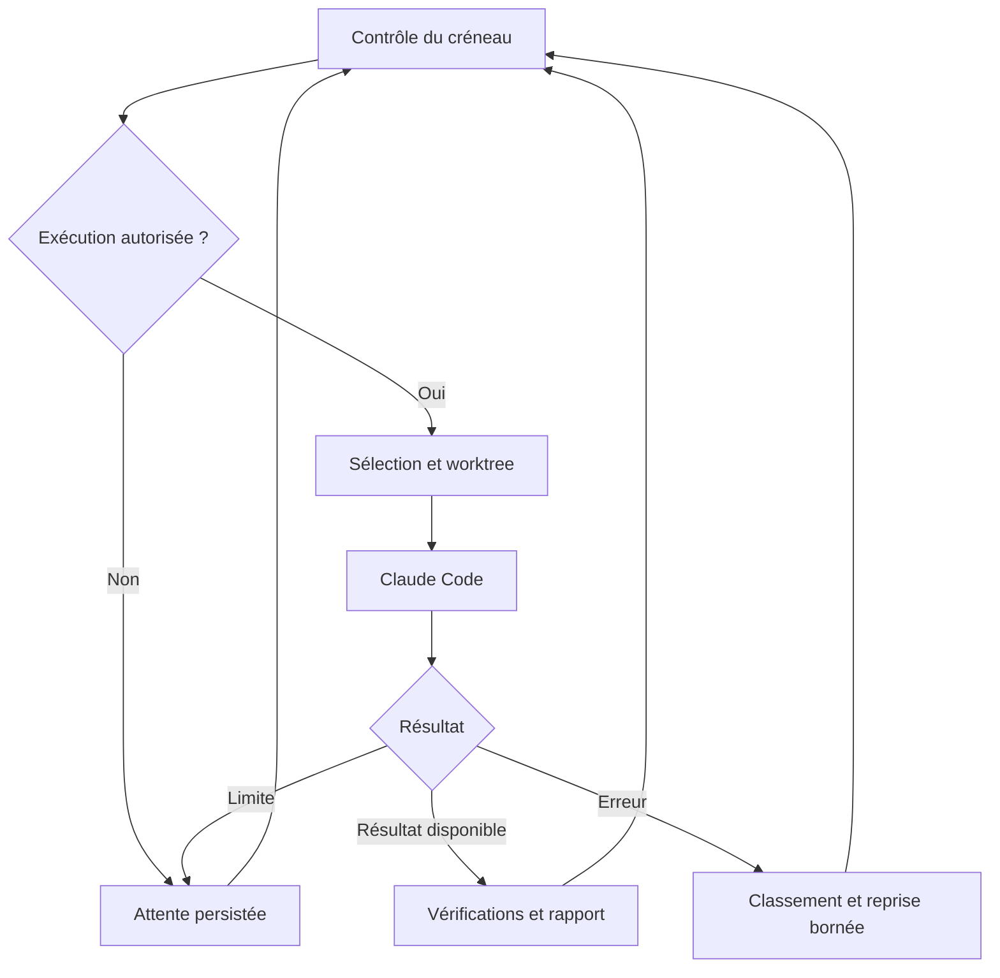

# Claude Nightshift

> Orchestrateur personnel de tâches de développement avec LangGraph, LangChain et Claude Code, sur macOS et Linux.

**Statut : projet à développer.** Ce README décrit la cible ; les commandes `nightshift` et les configurations ci-dessous sont des interfaces proposées, pas un logiciel déjà disponible. Plan de réalisation : [roadmap.md](roadmap.md).

## Objectif

Faire avancer des projets de code en arrière-plan pendant des créneaux configurables, en utilisant l'allocation disponible d'un abonnement Claude Pro. Le « token maxing » désigne ici la recherche du maximum de travail utile dans cette allocation : chaque exécution répond à une tâche identifiée et produit un résultat vérifiable.

L'application sélectionne une tâche, prépare un espace Git, appelle Claude Code, contrôle le résultat puis poursuit la file. Elle attend lorsque le créneau est fermé ou qu'une limite d'utilisation est signalée. Une file vide termine le travail : aucune tâche artificielle n'est créée pour consommer des tokens.

## Contexte et choix structurants

- Utilisateur unique, exécution locale sous macOS ou Linux.
- Abonnement Claude Pro annoncé autour de 20 € ; prix et conditions à vérifier dans le compte.
- Python 3.11 ou supérieur comme cible initiale.
- LangGraph porte le workflow et ses checkpoints ; LangChain Core fournit les outils typés et les modèles de messages si nécessaires.
- Le CLI officiel Claude Code exécute les tâches via `claude -p` avec l'authentification de l'utilisateur.
- Pas d'appel `ChatAnthropic` dans le chemin abonnement : cet adaptateur utiliserait l'API et une facturation distincte.
- Une seule tâche active sur une machine dans le MVP. Mac et Linux sont des cibles alternatives, pas un cluster distribué.

## Authentification et limites

La documentation consultée le 2 novembre 2026 indique que `claude -p` peut encore consommer l'allocation de l'abonnement. Ce comportement et les conditions d'utilisation constituent une dépendance externe à revalider avant l'implémentation et lors des mises à jour.

Le programme utilisera l'authentification officielle du CLI. Il ne lira ni ne réutilisera les jetons OAuth pour effectuer ses propres appels HTTP. Il vérifiera le mode d'authentification et refusera de démarrer en mode abonnement si une configuration API ou fournisseur tiers détectée contredit ce mode. Une variable `ANTHROPIC_API_KEY` peut notamment prendre priorité sur la connexion à l'abonnement.

Les crédits supplémentaires payants doivent être désactivés dans le compte pour viser un fonctionnement limité à l'allocation incluse. L'absence de clé API ne suffit pas à garantir l'absence de toute facturation supplémentaire.

Le service ne promet pas de connaître un pourcentage exact de quota restant. Le MVP réagit aux erreurs documentées et signaux observables du CLI. Si une date de réinitialisation fiable est disponible, elle est enregistrée ; sinon, une attente progressive et bornée s'applique. Les limites hebdomadaires et l'usage interactif partagé restent pris en compte dans les limites du signal disponible.

## Périmètre du MVP

| Fonction | Comportement attendu |
| --- | --- |
| File de travail | Tâches explicites importées depuis YAML et persistées en SQLite |
| Priorités | Priorité numérique, puis ordre d'arrivée ; aucune dépendance entre tâches au départ |
| Planning | Créneaux par jour en fuseau IANA, y compris passage de minuit |
| Exécution | CLI Claude Code, sorties structurées, permissions configurées, timeout |
| Git | Un worktree et une branche par tâche, base choisie explicitement |
| Vérification | Commandes de test configurées par l'utilisateur et contrôle des critères attendus |
| Reprise | Checkpoints LangGraph et journal des tentatives |
| Limites | Pause sur quota, reprise contrôlée, aucune boucle de relance rapide |
| Rapport | Résumé local : tâche, branche, diff, tests, erreurs, temps, usage disponible |
| Service | `launchd` sur macOS, `systemd --user` sur Linux |

La découverte autonome de tâches, l'interface web, les PR automatiques et la concurrence entre agents sont reportées après le MVP.

## Architecture

| Module envisagé | Responsabilité |
| --- | --- |
| `config.py` | Validation Pydantic de la configuration et des chemins |
| `scheduler.py` | Calcul des créneaux, délais et prochaines échéances |
| `queue.py` | Import idempotent, acquisition et changement d'état des tâches |
| `graph.py` | Graphe LangGraph et routage des résultats |
| `tools.py` | Outils LangChain typés pour les opérations approuvées |
| `claude_runner.py` | Lancement du CLI, arrêt du groupe de processus, normalisation des sorties |
| `git_workspace.py` | Création, contrôle et conservation des worktrees |
| `verification.py` | Exécution des vérifications explicites avec délai maximal |
| `storage.py` | SQLite applicatif, migrations et journal durable |
| `reporting.py` | Rapports Markdown et journaux JSONL |
| `cli.py` | Commandes utilisateur et gestion du service |

LangGraph pilote un workflow déterministe ; un second LLM superviseur n'est pas nécessaire pour distribuer les tâches. L'agent de développement reste Claude Code.



Les checkpoints sauvegardent l'état du graphe, pas un processus externe. Avant toute reprise d'un nœud à effets de bord, le système rapproche `task_id`, `attempt_id`, worktree et journal d'exécution. Un processus au résultat inconnu passe en `needs_review` plutôt que de relancer aveuglément une modification.

## Modèle de données proposé

- **Task** : identifiant stable, dépôt autorisé, référence Git de base, consigne, priorité, critères d'acceptation, commandes de vérification.
- **Attempt** : identifiant unique, tâche, dates, statut, worktree, branche, éventuel identifiant de session Claude, résultat normalisé, erreur, prochaine tentative.
- **ExecutionState** : identifiants de tâche et tentative, phase du graphe, échéance du créneau, compteur de reprises, motif de pause.
- **UsageObservation** : heure, source, tokens ou coût indicatif éventuellement fournis, limite signalée, réinitialisation connue ou inconnue.

États de tâche : `pending`, `running`, `waiting_limit`, `paused_schedule`, `needs_review`, `succeeded`, `failed`, `cancelled`. Une réussite annoncée par le modèle ne suffit pas : le statut dépend des vérifications prévues. Si une validation humaine reste nécessaire, utiliser `needs_review`.

## Configuration cible

Exemple à adapter ; ce schéma sera implémenté pendant la roadmap.

```yaml
timezone: Europe/Paris
schedule:
  windows:
    - days: [mon, tue, wed, thu, fri, sat, sun]
      start: '22:00'
      end: '07:00'
  stop_policy: strict
  shutdown_grace_seconds: 10
execution:
  concurrency: 1
  task_timeout_minutes: 30
  max_attempts_per_task: 3
  max_active_minutes_per_window: 240
  retry_backoff_seconds: [300, 900, 1800]
authentication:
  mode: claude_subscription
  reject_api_configuration: true
git:
  worktree_per_task: true
  auto_merge: false
storage:
  database: ./var/nightshift.sqlite
  checkpoints: ./var/checkpoints.sqlite
  reports: ./var/reports
```

Les jours désignent le jour de début du créneau : lundi 22 h–7 h finit mardi. Les fenêtres sont semi-ouvertes : début inclus, fin exclue. Les chevauchements sont fusionnés. Les timestamps persistés sont en UTC ; les créneaux suivent `Europe/Paris` et ses changements d'heure.

En mode `strict`, l'arrêt est demandé avant la fermeture pour absorber le délai de grâce ; à l'échéance, le groupe de processus est arrêté. Le travail partiel reste dans son worktree. Un arrêt local ne garantit pas l'annulation instantanée d'une requête déjà envoyée au fournisseur.

Le plafond de minutes limite l'usage nocturne mais ne représente pas un pourcentage garanti du quota. Le mode de réserve exacte attend une source de mesure officiellement exploitable.

## Exemple de tâche

```yaml
tasks:
  - id: add-distance-validation
    repository: /chemin/vers/geo-distance
    base_ref: main
    priority: 10
    prompt: >-
      Ajouter la validation des coordonnées géographiques dans la fonction
      de calcul de distance. Préserver le comportement des entrées valides.
    acceptance_criteria:
      - Latitude hors de [-90, 90] rejetée avec un message explicite.
      - Longitude hors de [-180, 180] rejetée avec un message explicite.
      - Tests de limites et de non-régression présents.
    verification_commands:
      - [python, -m, pytest, tests/test_distance.py, -q]
```

Les commandes de vérification proviennent de la configuration de confiance, sont exécutées comme listes d'arguments et ont leur propre timeout. Les chemins de dépôts sont explicitement autorisés. Les tâches ajoutées par une source externe ne deviennent pas exécutables sans validation.

## Parcours utilisateur cible

Les commandes suivantes sont à créer, elles ne sont pas encore disponibles :

```bash
nightshift doctor
nightshift tasks import tasks.yaml
nightshift tasks list
nightshift run --once
nightshift run --dry-run
nightshift service install
nightshift status
nightshift pause
nightshift resume
nightshift report --latest
```

`doctor` contrôlera Python, Git, le CLI Claude, sa version, l'authentification, les répertoires et la configuration. `--dry-run` devra simuler les décisions sans appel Claude ni modification du dépôt. Le service utilisera des chemins absolus et retrouvera l'authentification de l'utilisateur dans son environnement non interactif.

## Permissions et résultats

Le worktree sépare les modifications Git ; il ne constitue pas une sandbox de sécurité. Les outils Claude autorisés doivent être explicites, sans désactivation globale des permissions. Les hooks, configurations MCP et instructions présents dans les dépôts doivent être examinés avant activation du mode non interactif.

Les branches et diffs restent locaux dans le MVP. Les rapports identifient les fichiers modifiés, les tests exécutés et leur code de sortie. Les logs excluent les secrets et les informations d'authentification. Le nettoyage conserve les worktrees contenant un travail non validé.

## Mesures de réussite

- Tâches terminées et validées par créneau.
- Taux de réussite, reprises et interventions manuelles.
- Temps actif, attente quota et attente planning.
- Consommation mesurée uniquement si fournie ; valeur inconnue sinon.
- Aucun double lancement après redémarrage.
- Aucune activité locale lancée hors créneau.

## Références

Sources consultées pendant le cadrage du 2 novembre 2026 ; à revalider au jalon 0.

- [Claude Code en mode programmatique](https://code.claude.com/docs/en/headless)
- [Référence du CLI Claude Code](https://code.claude.com/docs/en/cli-reference)
- [Agent SDK et abonnement Claude](https://support.claude.com/en/articles/15036540-use-the-claude-agent-sdk-with-your-claude-plan)
- [Priorité des clés API](https://support.claude.com/en/articles/12304248-manage-api-key-environment-variables-in-claude-code)
- [Abonnement et limites Claude Code](https://support.claude.com/en/articles/11145838-use-claude-code-with-your-pro-max-or-ultra-plan)
- [Persistance LangGraph](https://docs.langchain.com/oss/python/langgraph/persistence)
- [Exécution durable LangGraph](https://docs.langchain.com/oss/python/langgraph/durable-execution)
